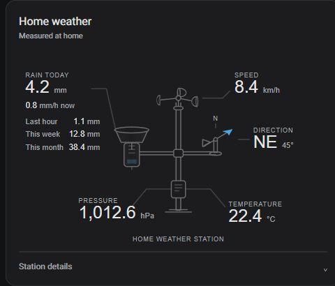

# Weather Station Card

An animated weather station for Home Assistant dashboards, with readings placed beside the instruments that measure them.



Wind cups rotate with wind speed, rain falls when the rain-rate sensor reports precipitation, and a wind vane points into the measured wind direction. On wide cards, a compact history panel appears alongside the station.

## Features

- Every sensor is optional. Omit a sensor to hide its reading, instrument and history graph.
- Units come from each sensor's `unit_of_measurement`; values are not converted.
- Configured sensors that are unavailable display a dash, rather than a false zero.
- Wind direction uses degrees: north is away from the viewer, east right, south toward the viewer, and west left.
- Responsive history panel with a 12-hour window, local-time labels and upper/lower value scales.
- History updates once a minute; the station readings follow Home Assistant updates.
- Tap or keyboard-activate a reading to open its Home Assistant history.
- Theme-aware colours and reduced-motion support for the station animation.

## Installation with HACS

This repository can be installed as a **custom repository**. It is not currently included in the default HACS catalogue.

1. Open **HACS**, select its three-dot menu, then **Custom repositories**.
2. Add `https://github.com/tiaanv/weather-station-card` with type **Dashboard**.
3. Find **Weather Station Card** and download the latest release.
4. Check **Settings → Dashboards → Resources** for the JavaScript module:

   ```text
   /hacsfiles/weather-station-card/weather-station-card.js
   ```

5. Refresh the browser or reopen the Home Assistant app.
6. Edit a dashboard, add a **Manual** card, and paste a configuration below.

For the optional wide history panel, also install **Mini Graph Card** from HACS and ensure its JavaScript resource is registered. The station graphic itself does not require Mini Graph Card. Set `show_history: false` to disable the panel.

Do not register both a manually installed resource and the HACS resource for this card.

## Manual installation

1. Download `weather-station-card.js` from the [latest release](https://github.com/tiaanv/weather-station-card/releases/latest).
2. Copy it to `<config>/www/weather-station-card.js` on Home Assistant.
3. Add `/local/weather-station-card.js?v=1.3.0` to dashboard **Resources** as a **JavaScript module**. Advanced mode may need to be enabled in your profile to see Resources.
4. Refresh the browser and add a Manual card.

For YAML-managed resources:

```yaml
lovelace:
  resources:
    - url: /local/weather-station-card.js?v=1.3.0
      type: module
```

When updating manually, replace the file and change the version query in the resource URL to clear browser caches. No Home Assistant restart is required for a normal resource update.

## Quick start

Replace these example IDs with your sensors. No sensor IDs are built into the card.

```yaml
type: custom:weather-station-card
name: Home weather
entities:
  rain_today: sensor.weather_rain_today
  rain_rate: sensor.weather_rain_rate
  wind_speed: sensor.weather_wind_speed_smoothed
  wind_direction_degrees: sensor.weather_wind_direction_smoothed
  temperature: sensor.weather_temperature
  pressure: sensor.weather_pressure
```

If your DIY station produces noisy wind readings, map `wind_speed` and `wind_direction_degrees` to your smoothed sensors. The card shows one speed and one direction; it does not calculate an average itself.

## Configuration

| Option | Default | Description |
| --- | --- | --- |
| `type` | Required | `custom:weather-station-card` |
| `name` | `Weather station` | Card heading |
| `show_history` | `true` | Show the side history panel when enough width is available |
| `entities` | `{}` | Optional sensor mappings listed below |

All entries under `entities` are optional:

| Key | Expected reading | Display |
| --- | --- | --- |
| `rain_today` | Numeric daily accumulation | Main rain reading |
| `rain_rate` | Numeric precipitation rate | Rate and rain animation; history graph |
| `rain_last_hour` | Numeric hourly accumulation | Rain details beside collector |
| `rain_this_week` | Numeric weekly accumulation | Rain details beside collector |
| `rain_this_month` | Numeric monthly accumulation | Rain details beside collector |
| `rain_total` | Numeric lifetime accumulation | Expandable station details |
| `rain_last_detected` | Timestamp or text | Last rainfall in station details |
| `wind_speed` | Numeric speed in the sensor's units | Speed and cup animation; history graph |
| `wind_direction_degrees` | Numeric degrees, 0–360 | Vane and compass heading; direction **from** which wind blows |
| `temperature` | Numeric temperature | Temperature reading and history |
| `pressure` | Numeric atmospheric pressure | Pressure reading and history |

The sensor defines the unit and value: for example, inches, mm, mph, km/h, hPa, inHg, °C or °F. The card does not convert between them. The degree direction input is the exception: supply degrees, not compass text or radians.

The wide panel appears at a **card width of 820 px**, not a particular screen width. It shows rain rate (or daily rain if no rate is configured), speed, temperature and pressure, including only configured sensors. Phones and narrower cards retain the graphic layout. The panel is constrained to the graphic's height.

The y-axis labels are the plotted scale bounds, not a fixed weather-warning scale. Time labels mark the start, midpoint and end of the 12-hour window. Missing recorder data may produce gaps or an empty graph. Rain accumulation resets are displayed as recorded; this is not a rainfall histogram or calculated hourly total.

## Example configurations

Full mapping: [examples/full.yaml](examples/full.yaml).

Rain only:

```yaml
type: custom:weather-station-card
name: Rain station
entities:
  rain_today: sensor.weather_rain_today
  rain_rate: sensor.weather_rain_rate
```

Wind only:

```yaml
type: custom:weather-station-card
name: Wind station
entities:
  wind_speed: sensor.weather_wind_speed_smoothed
  wind_direction_degrees: sensor.weather_wind_direction_smoothed
```

Without a history dependency:

```yaml
type: custom:weather-station-card
show_history: false
entities:
  temperature: sensor.outdoor_temperature
  pressure: sensor.atmospheric_pressure
```

Copyable files: [rain only](examples/rain-only.yaml), [wind only](examples/wind-only.yaml), [without history](examples/without-history.yaml).

## Troubleshooting

- **Custom element doesn't exist:** check that the resource is a JavaScript module, confirm its URL, and refresh the browser. Do not load duplicate copies.
- **A reading is hidden:** add its entity mapping. If an entity is configured but does not exist or is unavailable, its reading shows a dash.
- **No history panel:** check card width, `show_history`, and Mini Graph Card installation. History also requires Home Assistant recorder data for the sensors.
- **No units:** the sensor must provide `unit_of_measurement`; the card deliberately does not invent a unit.
- **No rain animation:** it requires a configured rain-rate sensor with a numeric value above zero. Daily rainfall alone does not imply rain now.
- **Vane orientation:** it points toward the reported source direction, with north receding into the picture. Do not add a 180° offset unless your sensor reports the opposite convention.
- **Animations disabled:** check your device's reduced-motion preference. Cup speed is illustrative, not a calibrated measurement of physical rotor RPM.

## Compatibility and development

Use a current Home Assistant frontend and modern browser with CSS container queries and `ResizeObserver`. The first public release is **v1.3.0**, matching the version tested during private development. Older browsers without container queries retain the narrow layout.

Legacy entity aliases remain accepted: `rain_mm_today`, `rain_rate_mm_per_hour`, `rain_mm_last_hour`, `rain_mm_this_week`, `rain_mm_this_month`, `rain_mm_total`, `wind_speed_kmh`, `temperature_celsius`, `pressure_hpa`, and the original short keys. Preferred names above are unit-neutral. Wind-direction quality is not used.

See [CONTRIBUTING.md](CONTRIBUTING.md) for build, validation and release steps. The standalone demo uses synthetic data and can be served with `node scripts/serve.mjs` at `http://localhost:8767/demo/`.

## License

[MIT](LICENSE). Optional history rendering is provided by the separately installed [Mini Graph Card](https://github.com/kalkih/mini-graph-card), licensed under MIT; its code is not bundled here.
